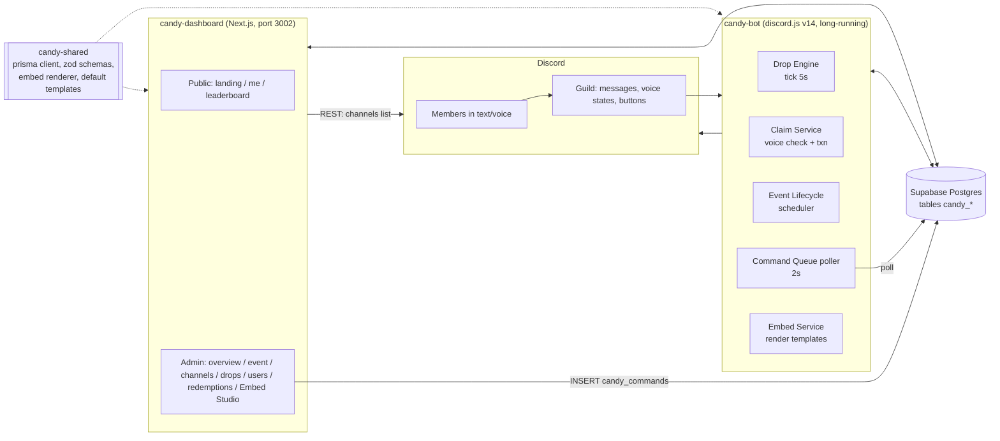

# 🎃 753BC — Trick or Treat "Candy Event" : System Design & Implementation Spec

> เอกสารนี้เขียนให้ **Gemini (หรือ AI Agent ตัวอื่น) ทำงานต่อได้ทันที** ครอบคลุม Bot + Web Dashboard + Database + Embed System
> ทุกอย่างของกิจกรรมนี้ **แยกจากระบบเดิมทั้งหมด** (คำสั่งบอท, หน้าเว็บ, ตาราง DB) แต่ใช้ **บอทตัวเดิม (Discord Application/Token เดียวกัน)** และ **Database เดิม (Supabase)**

---

## 0. อ่านก่อนลงมือ (Rules of Engagement สำหรับ Agent)

| # | กฎ | เหตุผล |
|---|-----|--------|
| R1 | **ห้ามแก้/ลบ** ไฟล์ใน `discord-community-web/` (เว็บเดิม) ยกเว้นระบุไว้ชัดเจน — ให้ *อ่านและคัดลอก* design system มาใช้ | แยกระบบ ไม่กระทบเว็บหลัก |
| R2 | **ห้ามรัน `prisma db push` / `prisma migrate dev/reset` กับ DB ตัวจริง** | DB เดียวกันมีตารางของ LynnBot (`users`, `settings`, ฯลฯ) ที่ **ไม่อยู่ใน schema.prisma** → Prisma จะพยายาม DROP ทิ้ง ดู §4.3 วิธีที่ปลอดภัย |
| R3 | ตารางใหม่ **ต้องขึ้นต้น `candy_`** (Prisma model ขึ้นต้น `Candy`) เท่านั้น ห้ามแตะตารางเดิม | แยก Database |
| R4 | ลงทะเบียน Slash Command ด้วย **POST/PATCH เฉพาะคำสั่ง `candy`** ห้ามใช้ bulk overwrite (`PUT .../commands`, `client.application.commands.set([])`) | bulk overwrite จะ **ลบคำสั่งของ LynnBot ทิ้ง** |
| R5 | custom_id ของปุ่ม/โมดัล **ต้องขึ้นต้น `candy:`** และบอทกิจกรรมต้อง **ไม่ตอบ** interaction ที่ไม่ใช่ `candy:` | ไม่ชนกับ handler เดิมของ LynnBot |
| R6 | ห้าม print/commit ค่าใน `.env` (token, secret) ลง log หรือไฟล์ | ความปลอดภัย |
| R7 | โปรเจกต์ Next.js เวอร์ชันนี้ **ไม่ใช่เวอร์ชันที่คุ้นเคย** — อ่าน `discord-community-web/AGENTS.md` และ `node_modules/next/dist/docs/` ก่อนเขียนโค้ด Next.js | มี breaking changes |
| R8 | ลูกอม = เงินจริง (1 ลูก = 1 บาท) → **ทุกการเปลี่ยนยอดต้องผ่าน transaction + ledger** และมี **งบรวมสูงสุด (budget cap)** ที่ระบบบังคับใช้ | ป้องกันจ่ายเกิน/โกง |

### เวลา (ตอนเขียนเอกสาร = 30 ต.ค. 17:35 น. เวลาไทย)
- กิจกรรม: **30 ต.ค. 23:30 → 31 ต.ค. 00:30 (Asia/Bangkok)** = **แค่ 1 ชั่วโมง**
- เหลือเวลาพัฒนา ≈ 6 ชม. → ทำตาม **Phase P0 → P1** ใน §11 (P0 ต้องเสร็จ ~20:30, Code freeze 21:30, Dry-run 21:30–23:00)
- เก็บเวลาใน DB เป็น UTC, แสดงผลเป็น `Asia/Bangkok`

---

## 1. สรุปกติกากิจกรรม + ค่าตัดสินใจเริ่มต้น

**กติกาจากผู้จัด (ห้ามเปลี่ยนความหมาย)**
1. กิจกรรมรันผ่านบอท (LynnBot — ระบบเฉพาะของเซิร์ฟ)
2. ลูกอมสุ่มดรอปตาม **ห้องข้อความที่กำหนดให้ดรอปได้**
3. **1 ลูกอม = 1 บาท**
4. รายละเอียดการแลกเงินจะแจ้งก่อนเริ่มกิจกรรม → ระบบแลกต้อง **ปรับตั้งค่าได้/เปิด-ปิดได้**
5. **เก็บลูกอมได้เฉพาะตอนอยู่ในห้องพูดคุยเสียง (Voice Channel) เท่านั้น**
6. ข้อความของบอทที่เกี่ยวกับลูกอม **เป็น Embed ทั้งหมด** และแก้ไขได้ทุกส่วนจากเว็บ
7. Embed เริ่มต้นใช้ **ธีมตามรูปที่ 2** ("Rulebook Pager" — ดู §7.5)

**ค่า Default (ปรับได้จากเว็บ — ที่ marked ⚠️ ต้องให้เจ้าของกิจกรรมกำหนดก่อนเริ่ม)**

| หัวข้อ | Default | หมายเหตุ |
|---|---|---|
| ⚠️ งบรวม `budgetTotal` | **ไม่มีค่า default — ต้องตั้งก่อน Start** | ระบบจะไม่ยอม Start ถ้าเป็น 0 |
| จำนวนคนเก็บต่อ 1 drop `maxClaimers` | 1 (ใครกดก่อนได้) | ตั้งเป็น >1 ได้ (ทุกคนได้เท่ากัน) |
| ขนาดลูกอมต่อ drop | สุ่มตามตาราง tier (1:60%, 2:25%, 5:10%, 10:4%, 20:1%) | แก้ได้ |
| อายุ drop `dropLifetimeSec` | 45 วินาที | หมดแล้วปุ่มถูกปิด |
| ต้องอยู่ห้องเสียงนานก่อนเก็บ `minVoiceSeconds` | 10 วินาที | กัน join→กดทันที→ออก |
| ห้อง AFK | เก็บไม่ได้ | |
| เพดานต่อคน `perUserMaxTotal` | ไม่จำกัด (null) | ⚠️ แนะนำตั้ง เช่น 100 |
| ค่าแลก `bahtPerCandy` | 1 | |
| เปิดแลกเงิน `redeemOpen` | **false** | เปิดเมื่อประกาศรายละเอียด |
| ยอดแลกขั้นต่ำ `minRedeem` | 1 | |
| ช่องทางจ่าย | PromptPay (เบอร์/เลขบัตร) | ปรับได้ — ฟิลด์ `payoutMethod` เป็น string |

---

## 2. Architecture



**หลักการสื่อสาร Web ↔ Bot = ผ่าน DB เท่านั้น** (ไม่มี HTTP ตรงระหว่างกัน):
- **Config / Embed Template**: Web เขียน → Bot poll `version`/`updatedAt` ทุก 10 วินาที แล้ว reload cache (หรือ `/candy reload`)
- **คำสั่งสั่งงานจากเว็บ** (start/pause/end, manual drop, cancel drop, โพสต์ panel, แก้ข้อความที่โพสต์แล้ว) → Web `INSERT candy_commands` → Bot poll ทุก 2 วินาที → ทำ → อัปเดต `status/result`
- **Heartbeat**: Bot เขียน `candy_settings['bot:heartbeat']` ทุก 10 วินาที → เว็บแสดงสถานะ Bot Online/Offline

> เหตุผลที่บอทต้องเป็น process แยก: ต้องใช้ Discord Gateway (voice state, message events) ซึ่งรันบน Cloudflare Workers (ที่เว็บเดิม deploy อยู่) ไม่ได้ → รัน `candy-bot` บนเครื่อง/โฮสต์เดียวกับ LynnBot หรือ VPS/Railway/PM2

---

## 3. โครงสร้าง Repo (สร้างใหม่ที่ `d:\WebUseLynn\`)

```text
d:\WebUseLynn\
├─ discord-community-web\        # เว็บเดิม — ห้ามแก้ (R1)
├─ candy-shared\                 # ⭐ แชร์ระหว่าง bot + web
│  ├─ prisma\schema.prisma       # เฉพาะ model Candy* (§4)
│  ├─ sql\001_init.sql           # สร้างจาก prisma migrate diff (§4.3)
│  └─ src\
│     ├─ generated\client\       # prisma client output (ไม่ชนกับ @prisma/client เดิม)
│     ├─ db.ts                   # export prisma singleton
│     ├─ config\schema.ts        # zod: EventConfig + defaults (§5)
│     ├─ embeds\schema.ts        # zod: EmbedTemplatePayload + Discord limits (§7.2)
│     ├─ embeds\registry.ts      # รายการ template key + ตัวแปรที่ใช้ได้ (§7.3)
│     ├─ embeds\defaults.ts      # default payload ทุก key (ธีมรูปที่ 2) (§7.5)
│     ├─ embeds\render.ts        # replaceVars + toDiscordMessage() + pager (§7.4)
│     └─ constants.ts            # prefix "candy:", ledger types, ฯลฯ
├─ candy-bot\                    # ⭐ บอทกิจกรรม (discord.js v14 + tsx)
│  └─ src\
│     ├─ index.ts · client.ts · env.ts
│     ├─ register-commands.ts    # POST/PATCH เฉพาะ /candy (R4)
│     ├─ commands\candy.ts       # slash command /candy ... (§6.3)
│     ├─ interactions\{router,claim,pager,panel,redeem}.ts
│     ├─ services\{eventService,dropEngine,claimService,walletService,budget,
│     │            voiceTracker,activityTracker,redeemService,embedService,commandQueue}.ts
│     └─ jobs\{tick,sweeper,configSync,heartbeat}.ts
└─ candy-dashboard\              # ⭐ เว็บใหม่ (Next.js App Router, port 3002)
   ├─ tokens.css · wrangler.json · next.config.ts · package.json
   └─ src\
      ├─ app\ (หน้า + API ดู §8)
      ├─ components\{ui,shared,admin,embed-studio}\
      └─ lib\{auth,admin,discord,r2}.ts
```

- **Alias**: ทั้ง bot และ dashboard ใช้ `@candy/shared` → `../candy-shared/src` ผ่าน `tsconfig.paths`; Next ต้องเปิด `experimental.externalDir: true` (ถ้า turbopack ไม่รับ ให้ fallback เป็น `"candy-shared": "file:../candy-shared"` + `transpilePackages`)
- Prisma client ของ candy **ต้องมี `output` แยก** (ดู §4.1) ไม่งั้น `prisma generate` จะเขียนทับ `@prisma/client` ของเว็บเดิม
- Dashboard ใช้ **Discord OAuth App เดิม** → ต้องเพิ่ม Redirect URI `http://localhost:3002/api/auth/callback/discord` (+ โดเมน production) ใน Discord Developer Portal (ให้ผู้ใช้ทำเอง)
- Env: ใช้ค่าชุดเดียวกับ `discord-community-web/.env` (คัดลอก key ที่จำเป็น: `DATABASE_URL, DIRECT_URL, AUTH_SECRET, DISCORD_CLIENT_ID, DISCORD_CLIENT_SECRET, DISCORD_GUILD_ID, DISCORD_BOT_TOKEN|DISCORD_TOKEN, ADMIN_DISCORD_IDS, R2_*`) + ใหม่: `CANDY_ANNOUNCE_CHANNEL_ID` (optional), `CANDY_ADMIN_ROLE_IDS` (optional, comma-separated), `AUTH_URL`

---

## 4. Database (Supabase Postgres — ตารางแยก `candy_*`)

### 4.1 `candy-shared/prisma/schema.prisma`

```prisma
generator client {
  provider = "prisma-client-js"
  output   = "../src/generated/client"   // ห้ามลบ — กันชนกับ client ของเว็บเดิม
}

datasource db {
  provider  = "postgresql"
  url       = env("DATABASE_URL")
  directUrl = env("DIRECT_URL")
}

enum CandyEventStatus { DRAFT SCHEDULED RUNNING PAUSED ENDED }
enum CandyDropStatus  { ACTIVE CLAIMED EXPIRED CANCELLED }
enum CandyDropSource  { SCHEDULER ADMIN }
enum CandyLedgerType  { DROP_CLAIM ADMIN_GIVE ADMIN_TAKE REDEEM_HOLD REDEEM_REFUND }
enum CandyRedeemStatus { PENDING APPROVED PAID REJECTED CANCELLED }
enum CandyCommandStatus { PENDING PROCESSING DONE FAILED }

/// กิจกรรม 1 รอบ (มี RUNNING/PAUSED ได้ทีละ 1 — บังคับด้วย partial unique index ใน SQL)
model CandyEvent {
  id              String           @id @default(cuid())
  name            String
  status          CandyEventStatus @default(DRAFT)
  startsAt        DateTime
  endsAt          DateTime
  budgetTotal     Int              @default(0)   // เพดานลูกอมที่แจกได้ทั้งหมด
  budgetReserved  Int              @default(0)   // จองไว้ใน drop ที่ยัง ACTIVE + ที่ถูกเก็บแล้ว
  budgetClaimed   Int              @default(0)   // ถูกเก็บจริง
  config          Json                            // EventConfig (§5)
  configVersion   Int              @default(1)
  createdBy       String?
  createdAt       DateTime         @default(now())
  updatedAt       DateTime         @updatedAt

  channels CandyChannel[]
  drops    CandyDrop[]
  claims   CandyClaim[]

  @@index([status])
  @@map("candy_events")
}

/// ห้องข้อความที่อนุญาตให้ดรอป
model CandyChannel {
  id        String   @id @default(cuid())
  eventId   String
  channelId String                       // Discord text channel id
  name      String?                      // cache ชื่อห้อง
  enabled   Boolean  @default(true)
  weight    Int      @default(1)         // น้ำหนักสุ่ม (คูณกับ activity)
  createdAt DateTime @default(now())

  event CandyEvent @relation(fields: [eventId], references: [id], onDelete: Cascade)

  @@unique([eventId, channelId])
  @@map("candy_channels")
}

model CandyDrop {
  id           String          @id @default(cuid())
  eventId      String
  channelId    String
  messageId    String?
  amount       Int                            // ลูกอมต่อผู้เก็บ 1 คน
  maxClaimers  Int             @default(1)
  claimedCount Int             @default(0)
  status       CandyDropStatus @default(ACTIVE)
  source       CandyDropSource @default(SCHEDULER)
  createdBy    String?                         // discordId ถ้า ADMIN
  expiresAt    DateTime
  closedAt     DateTime?
  createdAt    DateTime        @default(now())

  event  CandyEvent   @relation(fields: [eventId], references: [id], onDelete: Cascade)
  claims CandyClaim[]

  @@index([eventId, status])
  @@index([status, expiresAt])
  @@map("candy_drops")
}

model CandyClaim {
  id             String   @id @default(cuid())
  dropId         String
  eventId        String
  discordId      String
  amount         Int
  voiceChannelId String
  voiceSeconds   Int                           // อยู่ในห้องเสียงมานานเท่าไรตอนกด
  latencyMs      Int?                          // เวลาจาก drop → กด (ไว้ตรวจ bot/macro)
  createdAt      DateTime @default(now())

  drop  CandyDrop  @relation(fields: [dropId], references: [id], onDelete: Cascade)
  event CandyEvent @relation(fields: [eventId], references: [id], onDelete: Cascade)

  @@unique([dropId, discordId])
  @@index([eventId, discordId])
  @@index([createdAt])
  @@map("candy_claims")
}

/// กระเป๋าลูกอมต่อคน (แยกจาก balance เงินของ LynnBot)
model CandyWallet {
  id            String    @id @default(cuid())
  discordId     String    @unique
  username      String?
  displayName   String?
  avatar        String?
  balance       Int       @default(0)          // ใช้แลกได้
  totalEarned   Int       @default(0)
  totalRedeemed Int       @default(0)
  claimCount    Int       @default(0)
  blocked       Boolean   @default(false)
  blockReason   String?
  lastClaimAt   DateTime?
  createdAt     DateTime  @default(now())
  updatedAt     DateTime  @updatedAt

  @@index([totalEarned])
  @@map("candy_wallets")
}

/// บัญชีแยกประเภท: ทุกการเปลี่ยนยอดต้องมี 1 แถว (append-only)
model CandyLedger {
  id           String          @id @default(cuid())
  discordId    String
  delta        Int                              // + / -
  balanceAfter Int
  type         CandyLedgerType
  refType      String?                          // "drop" | "redemption" | "admin"
  refId        String?
  reason       String?
  actor        String?                          // discordId ผู้ทำ (admin) หรือ "system"
  createdAt    DateTime        @default(now())

  @@index([discordId, createdAt])
  @@index([refType, refId])
  @@map("candy_ledger")
}

model CandyRedemption {
  id           String            @id @default(cuid())
  discordId    String
  amount       Int                               // จำนวนลูกอมที่ขอแลก
  bahtAmount   Int                               // amount × bahtPerCandy ณ ตอนขอ
  payoutMethod String            @default("PROMPTPAY")
  payoutTarget String                             // เบอร์พร้อมเพย์/บัญชี
  accountName  String?
  status       CandyRedeemStatus @default(PENDING)
  rejectReason String?
  slipUrl      String?
  note         String?
  reviewedBy   String?
  reviewedAt   DateTime?
  paidAt       DateTime?
  createdAt    DateTime          @default(now())
  updatedAt    DateTime          @updatedAt

  @@index([discordId])
  @@index([status, createdAt])
  @@map("candy_redemptions")
}

/// Embed Template — 1 แถวต่อ 1 key (ดู §7)
model CandyEmbedTemplate {
  key         String   @id                       // เช่น "candy_drop"
  name        String
  category    String                              // drop | claim | error | panel | info | redeem | announce | admin
  enabled     Boolean  @default(true)
  payload     Json                                // EmbedTemplatePayload ที่ Publish แล้ว (บอทอ่านตัวนี้)
  draft       Json?                               // ฉบับร่างที่ยังไม่ Publish
  version     Int      @default(1)
  isDefault   Boolean  @default(true)             // true = ยังเป็นค่าเริ่มต้นจากโค้ด
  updatedBy   String?
  updatedAt   DateTime @updatedAt
  createdAt   DateTime @default(now())

  revisions CandyEmbedRevision[]

  @@index([category])
  @@map("candy_embed_templates")
}

model CandyEmbedRevision {
  id        String   @id @default(cuid())
  key       String
  version   Int
  payload   Json
  note      String?
  createdBy String?
  createdAt DateTime @default(now())

  template CandyEmbedTemplate @relation(fields: [key], references: [key], onDelete: Cascade)

  @@unique([key, version])
  @@map("candy_embed_revisions")
}

/// ข้อความ panel ที่เว็บ/บอทโพสต์ไว้ (เพื่อแก้ไขข้อความเดิมได้)
model CandyPostedMessage {
  id          String   @id @default(cuid())
  templateKey String
  channelId   String
  messageId   String
  createdBy   String?
  createdAt   DateTime @default(now())

  @@unique([channelId, messageId])
  @@index([templateKey])
  @@map("candy_posted_messages")
}

/// คิวคำสั่ง Web → Bot
model CandyCommand {
  id        String             @id @default(cuid())
  type      String                                // EVENT_START | EVENT_PAUSE | EVENT_RESUME | EVENT_END | DROP_NOW | DROP_CANCEL | POST_TEMPLATE | EDIT_POSTED | RELOAD | TEST_SEND
  payload   Json
  status    CandyCommandStatus @default(PENDING)
  result    Json?
  error     String?
  createdBy String?
  createdAt DateTime           @default(now())
  doneAt    DateTime?

  @@index([status, createdAt])
  @@map("candy_commands")
}

/// key-value เล็ก ๆ (redeemOpen, bahtPerCandy, redeemInfoText, bot:heartbeat ...)
model CandySetting {
  key       String   @id
  value     Json
  updatedAt DateTime @updatedAt

  @@map("candy_settings")
}

model CandyAuditLog {
  id        String   @id @default(cuid())
  actor     String
  action    String                                // เช่น "wallet.adjust", "embed.publish"
  target    String?
  meta      Json?
  createdAt DateTime @default(now())

  @@index([createdAt])
  @@index([actor])
  @@map("candy_audit_logs")
}
```

### 4.2 กฎการเปลี่ยนยอด (Invariants)
1. `candy_wallets.balance` เปลี่ยนได้เฉพาะใน `prisma.$transaction` ที่ **insert `candy_ledger` พร้อมกันเสมอ**
2. `balanceAfter` ใน ledger = ยอดหลังอัปเดตจริง (อ่านจากผล `UPDATE ... RETURNING`)
3. ห้ามให้ balance ติดลบ (`UPDATE ... WHERE balance >= $x`)
4. ตรวจสอบได้เสมอ: `SUM(delta) per discordId == wallet.balance` (ทำเป็นปุ่ม "Reconcile" ใน admin)
5. งบ: `budgetReserved <= budgetTotal` ตลอดเวลา (บังคับด้วย conditional UPDATE §6.5)

### 4.3 วิธีสร้างตารางอย่างปลอดภัย (แทน db push) — **ต้องทำตามนี้**

```bash
cd d:\WebUseLynn\candy-shared
npx prisma generate --schema prisma/schema.prisma
# --from-empty => สร้างเฉพาะ CREATE ของ candy_* เท่านั้น ไม่มี DROP ตารางอื่น
npx prisma migrate diff --from-empty --to-schema-datamodel prisma/schema.prisma --script > sql/001_init.sql
```
จากนั้น:
1. **ตรวจ `001_init.sql`** — ต้องมีแต่ `CREATE TYPE`/`CREATE TABLE`/`CREATE INDEX` ที่ชื่อขึ้นต้น `candy_`/`Candy` เท่านั้น (ห้ามมี `DROP`/`ALTER` ตารางอื่น)
2. ต่อท้ายไฟล์ด้วย partial unique index:
   ```sql
   CREATE UNIQUE INDEX candy_events_single_active
     ON candy_events ((1)) WHERE status IN ('RUNNING','PAUSED');
   ```
3. apply: `npx prisma db execute --file sql/001_init.sql --schema prisma/schema.prisma`
4. การแก้ schema ภายหลัง: ใช้ `migrate diff --from-schema-datamodel <old> --to-schema-datamodel <new> --script` แล้วตรวจก่อน apply เสมอ

---

## 5. Event Config (`CandyEvent.config` JSON, validate ด้วย zod)

```ts
// candy-shared/src/config/schema.ts  (ค่าด้านล่างคือ DEFAULT)
export const DEFAULT_EVENT_CONFIG = {
  announceChannelId: null as string | null,     // ห้องประกาศ start/end
  drop: {
    tickSeconds: 5,
    activityWindowSec: 120,        // นับข้อความมนุษย์ในห้องย้อนหลัง
    minActivityMessages: 3,        // ห้องต้องมีข้อความ >= ค่านี้ในช่วง window ถึงจะดรอปลงห้องนั้นได้
    channelCooldownSec: 20,        // ห้องเดียวกันห่างกันอย่างน้อย
    maxActivePerChannel: 1,
    maxActiveGlobal: 5,
    lifetimeSec: 45,
    maxClaimers: 1,
    amountTiers: [                 // weight รวมไม่ต้อง = 100
      { amount: 1, weight: 60 }, { amount: 2, weight: 25 },
      { amount: 5, weight: 10 }, { amount: 10, weight: 4 }, { amount: 20, weight: 1 },
    ],
    pacing: "BUDGET_AWARE" as "BUDGET_AWARE" | "FIXED_RATE",
    fixedDropsPerMinute: 4,        // ใช้เมื่อ FIXED_RATE
    dropWhenNoActivity: false,     // true = ดรอปแม้ห้องเงียบ (สุ่มห้องที่เปิดอยู่)
  },
  claim: {
    requireVoice: true,                  // 🔒 กติกาหลัก
    allowedVoiceChannelIds: [] as string[], // ว่าง = ทุกห้องเสียง
    excludeAfkChannel: true,
    requireNotDeafened: false,           // true = ห้าม self/server deaf
    minVoiceSeconds: 10,
    perUserCooldownSec: 3,
    perUserMaxTotal: null as number | null,   // เพดานลูกอมรวมต่อคน
    perUserMaxPerHour: null as number | null,
    minAccountAgeDays: 0,
    minServerJoinDays: 0,
  },
  redeem: { minRedeem: 1, maxRedeem: null as number | null, onePendingOnly: true },
};
```

`redeemOpen`, `bahtPerCandy`, ข้อความอธิบายการแลก เก็บใน `candy_settings` (เปลี่ยนได้ระหว่างกิจกรรมโดยไม่ต้อง bump event config)

---

## 6. Bot Design (`candy-bot`)

### 6.1 Runtime & Intents
- Node 20+, `discord.js@14`, `tsx`, ใช้ `DISCORD_BOT_TOKEN || DISCORD_TOKEN` (บอทตัวเดิม)
- Intents: `Guilds`, `GuildMessages` (ไม่ต้อง MessageContent — แค่นับ event), `GuildVoiceStates`, `GuildMembers` (ถ้าเปิดใน Portal แล้ว; ถ้าไม่ได้เปิดให้ fallback fetch รายคน)
- รัน 1 instance เท่านั้น (ใช้ PM2/โฮสต์เดียว) — ถ้ามีหลาย instance ตัว claim ยังปลอดภัยเพราะ atomic แต่ drop engine จะดรอปซ้ำ
- ⚠️ **ความเสี่ยง (ต้องตรวจ)**: บอททำงานเป็น 2 process ด้วย token เดียว (LynnBot เดิม + candy-bot) → ทั้งสองได้รับ `INTERACTION_CREATE` ทุกอัน ถ้า LynnBot มี handler ที่ตอบ error เมื่อ custom_id ไม่รู้จัก ปุ่ม `candy:*` จะโดนตอบซ้ำ → ต้องเพิ่ม guard 1 บรรทัดใน LynnBot: `if (customId?.startsWith("candy:") || commandName === "candy") return;` (ซอร์ส LynnBot ไม่ได้อยู่ใน workspace นี้ — แจ้งผู้ใช้ให้ตรวจ/แก้) ทางเลือกอื่น: รวมโค้ดเป็นโมดูลใน LynnBot ตรง ๆ โดยคง service layer เหมือนเอกสารนี้

### 6.2 Startup sequence
1. โหลด env → connect Prisma → `ready`
2. **Seed embed templates**: `INSERT ... ON CONFLICT DO NOTHING` จาก `defaults.ts` (ห้ามทับของที่แอดมินแก้แล้ว)
3. โหลด event ที่ `RUNNING/PAUSED/SCHEDULED` + channels + config + templates เข้า memory cache
4. **Recovery**: drop `ACTIVE` ที่ `expiresAt` ผ่านแล้ว → expire ทันที (edit ข้อความ + คืนงบ); ที่ยังไม่หมด → ใส่กลับเข้า sweeper
5. Hydrate voice tracker จาก `guild.voiceStates.cache` (`joinedAt = now` — เข้มงวดไว้ก่อน)
6. เริ่ม jobs: `tick` (5s), `sweeper` (5s), `commandQueue` (2s), `configSync` (10s), `heartbeat` (10s), `eventScheduler` (1s: SCHEDULED→RUNNING ที่ `startsAt`, RUNNING→ENDED ที่ `endsAt`)

### 6.3 Slash Commands — คำสั่งเดียว `/candy` พร้อม subcommand (ลงทะเบียนแบบ guild command เฉพาะ `candy`)

**ผู้เล่นทั่วไป** (ตอบเป็น embed ephemeral เว้นแต่ระบุ)
| คำสั่ง | หน้าที่ | Template |
|---|---|---|
| `/candy balance [user?]` | ดูลูกอม/มูลค่าเป็นบาท/อันดับ | `candy_balance` |
| `/candy leaderboard` | Top 10 + อันดับตัวเอง (public) | `candy_leaderboard` |
| `/candy history` | 10 รายการล่าสุดจาก ledger | `candy_history` |
| `/candy rules` | กติกาแบบหลายหน้า (pager) | `candy_rules` |
| `/candy redeem` | เปิด Modal กรอกพร้อมเพย์ (ถ้า `redeemOpen`) | `candy_redeem_*` |

**แอดมิน** (ตรวจสิทธิ์: `ADMIN_DISCORD_IDS` หรือ role ใน `CANDY_ADMIN_ROLE_IDS` หรือสิทธิ์ ManageGuild — ต่อให้ซ่อนด้วย `default_member_permissions` ก็ต้องเช็กซ้ำฝั่งโค้ด)
| คำสั่ง | หน้าที่ |
|---|---|
| `/candy event status` | สถานะ/งบ/จำนวน drop (`candy_admin_status`) |
| `/candy event start \| pause \| resume \| end` | ควบคุมกิจกรรม (ยืนยันด้วยปุ่มก่อน `end`) |
| `/candy drop now [channel] [amount] [claimers]` | ดรอปทันที |
| `/candy channel add \| remove \| list` | จัดการห้องที่ดรอปได้ |
| `/candy give user amount [reason]` · `/candy take user amount [reason]` | ปรับยอด (ลง ledger + audit) |
| `/candy block user [reason]` · `/candy unblock user` | แบนจากกิจกรรม |
| `/candy panel [template] [channel]` | โพสต์ panel (กติกา/ปุ่มเช็กยอด) |
| `/candy reload` | โหลด config/embed ใหม่ทันที |

ผลลัพธ์ของคำสั่งแอดมินทุกอันตอบเป็น embed (`candy_admin_*`) เช่นกัน

### 6.4 Interactions (custom_id schema — ทั้งหมดขึ้นต้น `candy:`)
| custom_id | ความหมาย |
|---|---|
| `candy:claim:<dropId>` | ปุ่มเก็บลูกอม |
| `candy:pg:<templateKey>:<pageIdx>` | ปุ่ม pager (ย้อนกลับ/ถัดไป) |
| `candy:btn:<action>` | ปุ่มบน panel: `balance` `leaderboard` `rules` `redeem` `history` |
| `candy:redeem:modal` | Modal ขอแลก (fields: payoutTarget, accountName, amount) |
| `candy:confirm:<action>:<token>` | ปุ่มยืนยันคำสั่งอันตราย (end event) |

ทุก handler: `deferReply({ephemeral:true})` / `deferUpdate()` ภายใน 3 วินาที, จับ error แล้วตอบ embed `candy_err_generic`, ห้าม throw หลุด

### 6.5 Drop Engine

**Activity tracker**: `messageCreate` (ไม่ใช่ bot/webhook) ในห้องที่เปิดอยู่ → เก็บ timestamp ลง ring buffer ต่อห้อง (in-memory) ใช้นับใน `activityWindowSec`

**Tick (ทุก `tickSeconds`)** — ทำเมื่อ event = RUNNING เท่านั้น:
```
remainingBudget = budgetTotal - budgetReserved
remainingSec    = endsAt - now           (ถ้า <= 0 → ไม่ดรอป)
avgCost         = E[amount] * maxClaimers            // จาก amountTiers
λ (drops/sec)   = BUDGET_AWARE ? (remainingBudget / remainingSec) / avgCost
                                : fixedDropsPerMinute / 60
P(drop this tick) = min(1, λ * tickSeconds)
if random() > P → จบ tick
candidates = enabled channels where
    activeDrops(channel) < maxActivePerChannel
    && now - lastDrop(channel) >= channelCooldownSec
    && (activity(channel) >= minActivityMessages || dropWhenNoActivity)
    && activeDropsGlobal < maxActiveGlobal
weight(ch) = ch.weight * (1 + activity(ch))
pick channel by weighted random → pick amount by tier weights
amount = min(amount, floor(remainingBudget / maxClaimers))  (ถ้า 0 → ไม่ดรอป)
createDrop(...)
```
เพราะคำนวณ λ ใหม่ทุก tick จากงบคงเหลือ/เวลาคงเหลือ + งบที่หมดอายุจะ "คืนเข้า pool" → งบถูกใช้สม่ำเสมอตลอด 1 ชั่วโมง ไม่หมดเร็วและไม่เหลือค้าง

**createDrop (atomic reserve)**
```sql
UPDATE candy_events
   SET "budgetReserved" = "budgetReserved" + $cost
 WHERE id = $eventId AND status = 'RUNNING'
   AND "budgetReserved" + $cost <= "budgetTotal";   -- cost = amount * maxClaimers
-- 0 rows => ไม่ดรอป (งบเต็ม)
```
แล้ว insert `candy_drops` → ส่ง embed `candy_drop` พร้อมปุ่ม → update `messageId`. ถ้าส่ง Discord ล้มเหลว → ยกเลิก drop + คืนงบ

**Sweeper (ทุก 5s)**: drop `ACTIVE` ที่ `expiresAt < now` → set `EXPIRED`, คืนงบ `budgetReserved -= (maxClaimers - claimedCount) * amount`, edit ข้อความเป็น `candy_drop_expired` และถอดปุ่ม

### 6.6 Claim Flow (หัวใจ — ต้องถูกต้อง 100%)

```
on button candy:claim:<dropId>:
 1. deferReply(ephemeral)
 2. event ต้อง RUNNING (cache)                      → candy_err_event_not_running
 3. wallet.blocked?                                  → candy_err_blocked
 4. 🔒 VOICE CHECK (ถ้า claim.requireVoice)
      vs = guild.voiceStates.cache.get(userId)
           ?? REST GET /guilds/{g}/voice-states/{userId}   (404 = ไม่ได้อยู่ในห้องเสียง)
      ไม่มี vs.channelId                              → candy_err_not_in_voice
      channel เป็น AFK (guild.afkChannelId)           → candy_err_voice_afk
      ไม่อยู่ใน allowedVoiceChannelIds (ถ้ากำหนด)     → candy_err_voice_not_allowed
      requireNotDeafened && (selfDeaf||deaf)         → candy_err_voice_deafened
      voiceTracker.secondsInVoice(userId) < minVoiceSeconds → candy_err_voice_too_short
 5. กฎอื่น: account age / server join age / cooldown ต่อคน / perUserMaxPerHour
 6. prisma.$transaction (interactive):
      a) ชิงช่อง (atomic):
         UPDATE candy_drops
            SET "claimedCount" = "claimedCount" + 1,
                status = CASE WHEN "claimedCount" + 1 >= "maxClaimers" THEN 'CLAIMED' ELSE status END,
                "closedAt" = CASE WHEN "claimedCount" + 1 >= "maxClaimers" THEN now() ELSE "closedAt" END
          WHERE id = $drop AND status = 'ACTIVE' AND "expiresAt" > now()
            AND "claimedCount" < "maxClaimers"
          RETURNING amount, "maxClaimers", "claimedCount";
         0 rows → rollback → candy_err_too_late (ตรวจเพิ่มว่าเคยเก็บเองแล้วไหม → candy_err_already_claimed)
      b) INSERT candy_claims (unique dropId+discordId — ชนคือ rollback → already_claimed)
      c) perUserMaxTotal: อ่าน/ล็อก wallet แล้วตรวจ totalEarned + amount <= เพดาน (เกิน → rollback → candy_err_cap_reached)
      d) UPSERT candy_wallets (balance += amount, totalEarned += amount, claimCount++, lastClaimAt, อัปเดต username/avatar)
      e) INSERT candy_ledger (DROP_CLAIM, delta=+amount, balanceAfter, refType='drop', refId=dropId)
      f) UPDATE candy_events SET budgetClaimed = budgetClaimed + amount
 7. editReply → candy_claim_success (ephemeral)
 8. update ข้อความ drop: ถ้า CLAIMED เต็ม → candy_drop_claimed (ถอดปุ่ม, แสดงผู้ชนะ) ; ถ้ายังไม่เต็ม → อัปเดต {claimedCount}/{maxClaimers}
```
- การ update ข้อความ drop ทำแบบ debounce (≤ 1 ครั้ง/วินาที ต่อ drop) เพื่อไม่ชน rate limit
- ใช้ `Promise` queue ต่อ dropId เพื่อลดการแย่งเมื่อคนกดพร้อมกันเยอะ (DB ยัง atomic อยู่แล้ว)

### 6.7 Voice Tracker
`voiceStateUpdate`: เก็บ `joinedAt` ต่อ user เมื่อเข้า/ย้าย **ถือว่าย้ายห้องไม่รีเซ็ต** (รีเซ็ตเฉพาะเมื่อออกจากเสียงทั้งหมด) และ `secondsInVoice(userId)`

### 6.8 Anti-abuse (สรุป)
- ชิงแบบ atomic + unique(dropId, discordId) → กดซ้ำ/พร้อมกันไม่ได้
- `minVoiceSeconds`, ห้อง AFK, optional ห้ามปิดหูฟัง, cooldown ต่อคน, เพดานต่อคน/ชั่วโมง, อายุบัญชี
- บันทึก `latencyMs` และ `voiceSeconds` ทุก claim → หน้า Admin "Suspicious" (กดเร็วผิดมนุษย์ < 250ms ซ้ำ ๆ, คนเดียวได้เกินค่าเฉลี่ย 3σ)
- Block ผู้ใช้ได้ทั้งจากบอท/เว็บ + ตรวจ **ก่อนจ่ายเงินจริง** ในหน้า Redemptions (แสดงธง suspicious)
- ไม่เชื่อ client: ทุกอย่างตัดสินในบอท/DB

### 6.9 Error handling & Ops
- ทุก job ห่อ try/catch + log (ไม่ล้มทั้ง process); `process.on('unhandledRejection')` log อย่างเดียว
- Discord REST 429 → discord.js จัดการ queue ให้; ถ้า edit ข้อความ drop ล้มเหลว ไม่กระทบยอด (DB คือ source of truth)
- Graceful shutdown (SIGINT): หยุด tick, flush
- Log เป็น JSON line (`level, event, dropId, userId`) เพื่อไล่ปัญหาหลังกิจกรรม

---

## 7. Embed System (หัวใจของ "ปรับได้ทุกส่วนจากเว็บ")

### 7.1 หลักการ
- ข้อความทุกชนิดที่บอทกิจกรรมส่ง = **Embed Template** ใน `candy_embed_templates` (ไม่ hardcode ข้อความในโค้ด)
- โค้ดมี `defaults.ts` เป็นค่าเริ่มต้น + seed ตอนบอทบูต; เว็บแก้ → `draft` → กด **Publish** → `payload` + `version++` + บันทึก `candy_embed_revisions` → บอทดึงภายใน ≤10 วินาที
- ปุ่ม **Reset to default** = ดึงจาก `defaults.ts`; **Rollback** = เลือก revision
- ถ้า template ถูกปิด (`enabled=false`) หรือ payload พัง → บอท fallback ไปใช้ default ในโค้ด (ห้ามไม่ตอบผู้ใช้)

### 7.2 Payload Schema (`embeds/schema.ts`)

```ts
type EmbedTemplatePayload = {
  content?: string;                    // ข้อความนอก embed (รองรับตัวแปร)
  ephemeral?: boolean;                 // ใช้กับ interaction reply
  pages: EmbedPage[];                  // >=1 ; >1 = มี pager
  pager: {
    enabled: boolean;                  // auto = pages.length > 1
    prevLabel: string;                 // "◀ ย้อนกลับ"
    nextLabel: string;                 // "ถัดไป ▶"
    prevStyle: ButtonStyle; nextStyle: ButtonStyle;   // ดีฟอลต์: secondary / primary
    disableAtEdges: boolean;           // true = ปิดปุ่มเมื่อสุดหน้า (ตามรูปที่ 2)
  };
  buttons: ButtonDef[][];              // แถวละ ≤5 ปุ่ม, ≤4 แถว (เหลือ 1 แถวให้ pager)
  allowedMentions: "NONE" | "USER_ONLY";   // ห้ามเปิด everyone/role จาก template
};

type EmbedPage = {
  color: string;                       // "#A0714F"
  author?: { name: string; iconUrl?: string; url?: string };
  title?: string; url?: string;        // ≤256
  description?: string;                // markdown ≤4096 (รองรับ # ## ### -# ``` `code` > ตัวแปร)
  thumbnail?: string; image?: string;  // URL (รองรับอัปโหลด R2)
  fields?: { name: string; value: string; inline: boolean }[];   // ≤25
  footer?: { text: string; iconUrl?: string };                   // ≤2048
  timestamp?: boolean | "event_start" | "now";
};

type ButtonDef = {
  id: string;
  label: string; emoji?: string;
  style: "primary" | "secondary" | "success" | "danger" | "link";
  action: "claim" | "balance" | "leaderboard" | "rules" | "redeem" | "history" | "link" | "none";
  url?: string;                        // เฉพาะ style=link
  disabled?: boolean;
};
```
- `action` เป็น **enum ที่โค้ดรองรับเท่านั้น** (แอดมินเลือกพฤติกรรมได้ แต่สร้าง action ใหม่เองไม่ได้) → ปลอดภัย
- zod ตรวจ Discord limits: รวมตัวอักษรทั้ง embed ≤ 6000, fields ≤ 25, name ≤256, value ≤1024, label ปุ่ม ≤80, URL ต้อง `https://`; **แสดง error/warning เป็นรายฟิลด์ในหน้า Studio** และ **ห้าม Publish ถ้า invalid**

### 7.3 Template Registry (`embeds/registry.ts`) — รายการ key + ตัวแปร

ตัวแปรใช้รูปแบบ `{name}` ; ตัวแปรเวลาแปลงเป็น Discord timestamp (`{expiresR}` → `<t:UNIX:R>`, `{endsAt}` → `<t:UNIX:F>`)
ตัวแปรกลางทุก template: `{eventName} {startsAt} {endsAt} {budgetLeft} {bahtPerCandy} {serverName}`

| Key | หมวด | เมื่อไหร่ใช้ | ตัวแปรเฉพาะ |
|---|---|---|---|
| `candy_drop` | drop | ลูกอมดรอปในห้องข้อความ (มีปุ่มเก็บ) | `{amount} {maxClaimers} {claimedCount} {expiresR} {channel} {dropShortId}` |
| `candy_drop_claimed` | drop | drop ถูกเก็บครบ | `{amount} {winners} {winner} {dropShortId}` |
| `candy_drop_expired` | drop | หมดเวลา | `{amount} {claimedCount} {maxClaimers}` |
| `candy_claim_success` | claim | ตอบคนที่เก็บสำเร็จ (ephemeral) | `{user} {amount} {balance} {baht} {voiceChannel}` |
| `candy_err_not_in_voice` | error | **ไม่ได้อยู่ห้องเสียง** | `{user}` |
| `candy_err_voice_afk` · `_voice_not_allowed` · `_voice_deafened` · `_voice_too_short` | error | เงื่อนไขเสียงอื่น | `{user} {minVoiceSeconds} {remainingVoiceSec}` |
| `candy_err_too_late` · `_already_claimed` · `_blocked` · `_event_not_running` · `_cap_reached` · `_cooldown` · `_generic` | error | | `{user}` (+ `{cap}` `{cooldownSec}`) |
| `candy_balance` | info | `/candy balance` | `{user} {balance} {baht} {totalEarned} {claimCount} {rank} {redeemStatus}` |
| `candy_leaderboard` | info | อันดับ | `{rows} {rank} {user}` (`{rows}` = บล็อกข้อความที่โค้ดสร้าง) |
| `candy_history` | info | ประวัติ | `{rows}` |
| `candy_rules` | panel | กติกา (หลายหน้า, pager) | – |
| `candy_panel_main` | panel | panel ถาวรในห้อง (ปุ่ม: ยอดลูกอม/อันดับ/กติกา/แลกเงิน) | – |
| `candy_redeem_info` | redeem | อธิบายวิธีแลก | `{minRedeem} {maxRedeem}` |
| `candy_redeem_closed` | redeem | ยังไม่เปิดแลก | – |
| `candy_redeem_submitted` · `_approved` · `_paid` · `_rejected` | redeem | แจ้งผู้ใช้ (ephemeral/DM) | `{amount} {baht} {payoutTarget} {reason} {redemptionId}` |
| `candy_event_start` · `_pause` · `_resume` · `_end` | announce | ประกาศในห้อง announce | `{budgetTotal} {totalDrops} {totalClaimed} {topRows}` |
| `candy_admin_status` · `_ok` · `_error` | admin | ผลคำสั่งแอดมิน | `{message} {…}` |

หมายเหตุ: ตัวแปรที่ไม่รู้จักใน template → คงไว้ตามเดิม (ไม่ crash) และ Studio เตือนสีเหลือง

### 7.4 Render Pipeline (`embeds/render.ts` — ใช้ร่วมกันทั้ง bot และ web preview)
```
renderTemplate(payload, vars, pageIdx=0, ctx) →
  { content, embeds:[discordEmbed], components:[rows], allowed_mentions }
```
1. `replaceVars()` ทุก string (title/description/fields/footer/author/button label/content) — escape ค่าตัวแปรที่มาจากผู้ใช้ (ชื่อ) ให้ไม่ทำ markdown/mention แทรก
2. แปลง `color` hex → int, ตัด field ที่ว่าง
3. ปุ่ม: `action` → `custom_id` (`candy:claim:<dropId>`, `candy:btn:balance`, ...) ; `link` → URL button
4. Pager: ถ้า pages>1 → แถวสุดท้ายเป็นปุ่ม `candy:pg:<key>:<idx-1>` / `candy:pg:<key>:<idx+1>`; footer รองรับ `{page}` `{pages}`; ปิดปุ่มที่ขอบ
5. `allowed_mentions`: `NONE` → `{parse:[]}` ; `USER_ONLY` → `{parse:[],users:[userId]}` (**ไม่เคยอนุญาต everyone/roles**)

### 7.5 ธีมเริ่มต้น "Rulebook Pager" (ถอดจากรูปที่ 2)

โครงของ embed ในรูป (ลูกกระจ๊อกบัง — กติกา 5/5):
| ส่วนในรูป | ค่าใน payload |
|---|---|
| แถบซ้าย สีทองแดง | `color: "#A0714F"` (sample จากพิกเซลจริง) |
| ชื่อเรื่องตัวหนา เล็ก | `title: "กติกา {page}/{pages} — …"` |
| หัวใหญ่ | บรรทัดแรกของ `description`: `# …` (Markdown H1) |
| "chip" ขอบมนเล็ก ๆ | inline code: `` `ข้อความ` `` |
| หัวข้อย่อยหนา | `### …` (H3) |
| กล่องโค้ดสีเขียว/แดง | code block ภาษา `diff` (`+` เขียว, `-` แดง) |
| บรรทัดตกแต่ง | `୨ৎ . The Astral Realm x 753BC . ୨ৎ` และเส้น `◠◠◠◠◠…` |
| Footer เล็ก | `footer.text: "หน้า {page}/{pages} • …"` |
| ปุ่ม `◀ ย้อนกลับ` (เทา) / `ถัดไป ▶` (น้ำเงิน, disabled หน้าสุดท้าย) | `pager.*` (`disableAtEdges: true`) |

ทุก template เริ่มต้น **ต้องยึดโครงนี้** (title → `# H1` → chip → `### H3` → diff block → บรรทัดตกแต่ง → footer) เปลี่ยนแค่เนื้อหา/อีโมจิ Halloween ตัวอย่าง default (เก็บใน `defaults.ts`):

````ts
export const DEFAULT_THEME = {
  color: "#A0714F",
  decoLine: "୨ৎ . 753BC x Trick or Treat . ୨ৎ",
  divider: "◠".repeat(24),
};

// candy_drop
{
  pages: [{
    color: "#A0714F",
    title: "🎃 ลูกอมหล่นแล้ว! — Trick or Treat",
    description: [
      "# 🍬 ลูกอม {amount} ลูก",
      "`ต้องอยู่ในห้องพูดคุยเสียงเท่านั้นถึงจะเก็บได้`",
      "",
      "### วิธีเก็บ:",
      "```diff",
      "+ เข้าห้องพูดคุยเสียงก่อน",
      "+ กดปุ่มด้านล่างให้ไวที่สุด",
      "- ไม่อยู่ในห้องเสียง = เก็บไม่ได้",
      "```",
      "หมดเวลา {expiresR}",
      "",
      "୨ৎ . 753BC x Trick or Treat . ୨ৎ",
      "◠◠◠◠◠◠◠◠◠◠◠◠◠◠◠◠◠◠◠◠◠◠◠◠",
    ].join("\n"),
    footer: { text: "เก็บแล้ว {claimedCount}/{maxClaimers} • #{dropShortId}" },
  }],
  pager: { enabled: false, prevLabel: "◀ ย้อนกลับ", nextLabel: "ถัดไป ▶", prevStyle: "secondary", nextStyle: "primary", disableAtEdges: true },
  buttons: [[{ id: "claim", label: "เก็บลูกอม", emoji: "🍬", style: "success", action: "claim" }]],
  allowedMentions: "NONE",
}

// candy_err_not_in_voice  (ephemeral)
{
  ephemeral: true,
  pages: [{
    color: "#A0714F",
    title: "เก็บลูกอมไม่ได้",
    description: [
      "# คุณยังไม่อยู่ในห้องเสียง",
      "`กติกา: เก็บลูกอมได้เฉพาะตอนอยู่ในห้องพูดคุยเสียง`",
      "",
      "### ทำตามนี้:",
      "```diff",
      "+ เข้าห้องพูดคุยเสียงห้องใดก็ได้",
      "+ แล้วกดปุ่มเก็บลูกอมใหม่อีกครั้ง (ถ้ายังไม่หมดเวลา)",
      "```",
      "୨ৎ . 753BC x Trick or Treat . ୨ৎ",
    ].join("\n"),
    footer: { text: "ลูกอมไม่ถูกหักจากการกดผิด" },
  }],
  ...
}
````

`candy_rules` ให้ทำ **5 หน้าแบบรูปที่ 2** (ภาพรวม → วิธีรับลูกอม → เงื่อนไขห้องเสียง → การแลกเงิน/อัตรา 1:1 → ข้อห้าม/การตัดสิทธิ์) ใช้ footer `หน้า {page}/{pages} • …`

> สำหรับ Agent: ตอนสร้าง default ครบทุก key ให้ใช้ helper `buildThemedPage({title, h1, chip, h3, diffLines, footer})` เพื่อให้ธีมสม่ำเสมอ และแก้ธีมจากจุดเดียวได้

---

## 8. Web Dashboard (`candy-dashboard`)

### 8.1 Design System — **ใช้ UX/UI เดิม**
คัดลอกจาก `discord-community-web` (ไม่ import ข้ามโปรเจกต์):
- `tokens.css`, `globals.css` (Tailwind v4, พื้นดำ `#070809`, hairline border `rgba(255,255,255,.08)`, มุมคม, ฟอนต์ Google Sans + Noto Sans Thai, scrollbar แบบเดิม)
- `components/ui/{Button,CaptionRow,FeatureCell,PageFrame,SectionStrip,StatusChip,TabRow}.tsx`, `components/shared/{InteractiveDotGrid,ScrollReveal,AuthProvider}.tsx`
- แนวทาง: Bento Grid, ปุ่ม primary สีขาวตัวอักษรดำ, accent เขียว emerald (สถานะดี), **accent ส้ม `--color-accent-orange` ใช้เป็นสีธีมกิจกรรม** (ตัวเลขลูกอม, progress งบ), CaptionRow เป็นหัวข้อ section
- ก่อนเขียนหน้าใหม่ ให้อ่าน `admin/AdminClient.tsx`, `components/admin/EmbedStudioTab.tsx`, `login/LoginClient.tsx` เพื่อคง pattern เดิม (TanStack Query, StatusChip, TabRow)
- Dashboard shell: **Sidebar ซ้าย** (collapsible บนมือถือ → drawer) + top bar (Bot status pill, Event status chip + countdown, avatar) — ต่างจากเว็บเดิมที่ใช้ TabRow เพราะหน้ามากกว่า
- Responsive ทุกหน้า; ตารางบนมือถือแปลงเป็น card list; inputs ฟอนต์ ≥16px (กัน iOS zoom — มีใน globals เดิมแล้ว)

### 8.2 Auth & Authorization
- NextAuth v5 + Discord provider (คัดลอก pattern `src/lib/auth.ts` แต่ **ตัดส่วน INSERT ตาราง `users` ของเว็บเดิมออก** — เว็บนี้ไม่แตะตารางเดิม; อัปเดตเฉพาะ `candy_wallets` (username/avatar) เมื่อ login)
- Session JWT เก็บ `discordId`; `isAdmin` = `ADMIN_DISCORD_IDS` ∋ discordId (หรือมี role ใน `CANDY_ADMIN_ROLE_IDS` ตรวจผ่าน bot token REST ตอน login แล้วใส่ใน JWT)
- **เช็กสิทธิ์ฝั่ง server ทุก API `/api/admin/*` และทุก page `/admin/*` (server component redirect)** — *ต่างจากโค้ดเดิมที่ปล่อยผ่านใน dev*: เว็บนี้บังคับทุก environment (มี `CANDY_DEV_BYPASS=true` เฉพาะ local ถ้าจำเป็น, default ปิด)
- ผู้ใช้ทั่วไป: เห็นเฉพาะข้อมูลตัวเอง

### 8.3 หน้าเว็บ

**Public / Member**
| Route | เนื้อหา |
|---|---|
| `/` | Landing กิจกรรม (Bento): นับถอยหลัง/สถานะสด, 1 ลูกอม = 1 บาท, วิธีเล่น 3 ขั้น (เข้าห้องเสียง → รอลูกอมดรอป → กดเก็บ), ตัวเลขสด (ลูกอมที่เก็บแล้ว), Top 5 |
| `/leaderboard` | อันดับทั้งหมด (polling 5s, ไม่แสดงข้อมูลส่วนตัวนอกจากชื่อ/อวตาร) |
| `/me` | (login) กระเป๋า, ประวัติ ledger, สถานะ/ปุ่มขอแลก (แสดงเมื่อ `redeemOpen`), ประวัติคำขอแลก |
| `/rules` | กติกา (ดึงข้อความจาก template `candy_rules` มา render แบบเดียวกับ Preview เพื่อไม่ต้องเขียนซ้ำ) |
| `/login` | Discord OAuth (หน้าตาเดิม) |

**Admin (`/admin/*`)**
| Route | ฟังก์ชัน |
|---|---|
| `/admin` | **Overview**: KPI (งบ ใช้แล้ว/จอง/คงเหลือ + progress bar ส้ม, drops/min, claims/min, ผู้เล่นในห้องเสียงตอนนี้, ผู้เก็บไม่ซ้ำ), กราฟ claims ต่อนาที, live feed drop/claim ล่าสุด, Bot status pill (heartbeat) — polling 3s |
| `/admin/event` | สร้าง/แก้กิจกรรม: ชื่อ, เวลา, **งบรวม**, ฟอร์มตั้งค่า §5 ทั้งหมด (กลุ่ม Drop / Claim / Redeem พร้อมคำอธิบาย), ปุ่ม **Start / Pause / Resume / End** (ยืนยัน + พิมพ์ชื่อกิจกรรมก่อน End), "Pre-flight checklist" (งบ>0, มีห้องอย่างน้อย 1, บอทออนไลน์, template พร้อม, ห้อง announce) |
| `/admin/channels` | ดึงห้องข้อความ/เสียงจาก Discord REST (cache 60s) → สวิตช์เปิดดรอป + weight + แสดง activity ล่าสุด; ตั้ง allowed voice channels; ปุ่ม "ดรอปทดสอบในห้องนี้" |
| `/admin/drops` | ตาราง drop ทั้งหมด (สถานะ/ห้อง/จำนวน/ผู้เก็บ) + **Manual Drop** (ห้อง, amount, claimers) + Cancel drop ที่ ACTIVE |
| `/admin/claims` | Audit log การเก็บ + ฟิลเตอร์ + แท็บ **Suspicious** (latency ต่ำผิดปกติ, ผู้เก็บสูงผิดปกติ) + Export CSV |
| `/admin/users` | ค้นหา wallet, ดู ledger, **ปรับยอด (+/- พร้อมเหตุผล บังคับกรอก)**, Block/Unblock, ปุ่ม Reconcile |
| `/admin/redemptions` | คิวคำขอแลก: Approve/Reject(เหตุผล)/Mark Paid (แนบสลิป R2 presign ได้) + ธง suspicious + Export CSV สำหรับโอนเป็นชุด + สรุปยอดบาทรวมที่ต้องจ่าย; สวิตช์ `redeemOpen`, `bahtPerCandy`, ข้อความอธิบายการแลก |
| `/admin/embeds` | **Embed Studio** (§8.5) |
| `/admin/logs` | `candy_audit_logs` + `candy_commands` (สถานะคำสั่งที่ส่งให้บอท) |

### 8.4 API Routes (`src/app/api/...`; ทุก `/admin/*` ตรวจ admin + zod + เขียน audit log)

| Method & Path | หน้าที่ |
|---|---|
| `GET /api/public/stats` | ตัวเลขสาธารณะ (cache 5s) |
| `GET /api/leaderboard` | อันดับ |
| `GET /api/me` · `GET /api/me/ledger` | กระเป๋าตัวเอง |
| `POST /api/me/redeem` | ขอแลก (transaction: ตรวจ `redeemOpen`/min/max/pending เดียว → หักยอด `REDEEM_HOLD` → insert redemption) |
| `GET/PUT /api/admin/event` | ดู/แก้กิจกรรม (แก้ config → `configVersion++`) |
| `POST /api/admin/event/command` | `{type: START\|PAUSE\|RESUME\|END}` → insert `candy_commands` (ไม่เปลี่ยน status เอง — รอบอทยืนยัน) |
| `GET/PUT /api/admin/channels` · `GET /api/admin/discord/channels` | จัดการห้อง |
| `GET /api/admin/overview` | KPI + feed |
| `GET /api/admin/drops` · `POST /api/admin/drops` (manual) · `DELETE /api/admin/drops/[id]` | |
| `GET /api/admin/claims` (+`?suspicious=1`, `?format=csv`) | |
| `GET /api/admin/users` · `POST /api/admin/users/[discordId]/adjust` · `.../block` | ปรับยอดใช้ transaction + ledger เดียวกับบอท (เขียนเป็นฟังก์ชันใน `candy-shared` เพื่อไม่ซ้ำ) |
| `GET /api/admin/redemptions` · `PATCH /api/admin/redemptions/[id]` | approve/reject (reject → `REDEEM_REFUND`) / paid |
| `GET/PUT /api/admin/settings` | `redeemOpen`, `bahtPerCandy`, ข้อความแลก |
| `GET /api/admin/embeds` · `GET/PUT /api/admin/embeds/[key]` (บันทึก draft) | |
| `POST /api/admin/embeds/[key]/publish` · `/reset` · `/rollback` · `GET .../revisions` | |
| `POST /api/admin/embeds/[key]/test-send` | insert `candy_commands TEST_SEND` (channelId หรือส่ง DM แอดมิน) |
| `POST /api/admin/embeds/[key]/post` | โพสต์ลงห้อง (บันทึก `candy_posted_messages`) · `PATCH` = แก้ข้อความที่โพสต์แล้ว |
| `POST /api/admin/upload` | R2 presign สำหรับรูป embed (คัดลอกแพทเทิร์น `topup/presign`; จำกัด `image/png,jpeg,webp,gif` ≤ 8MB, prefix `candy/`) |
| `GET /api/admin/bot/status` | อ่าน heartbeat |

### 8.5 Embed Studio (`/admin/embeds`) — ต้องจัดการ embed ได้ **ทุกส่วน**

Layout 3 คอลัมน์ (มือถือ = แท็บสลับ):
1. **ซ้าย — Template list**: ค้นหา, จัดกลุ่มตามหมวด (§7.3), badge `Default / Customized / Draft / Disabled`, สวิตช์ enabled, Duplicate (สร้าง key `custom_*` ได้), Import/Export JSON
2. **กลาง — Editor** (แท็บ):
   - **Message**: `content`, ephemeral, allowedMentions
   - **Embed / Pages**: เพิ่ม/ลบ/ลากสลับหน้า; ต่อหน้า: color (color picker + preset ธีมกิจกรรม: ทองแดง `#A0714F`, ส้ม `#F97316`, ม่วง `#8B5CF6`, เขียว `#10B981`, แดง `#EF4444`), author(ชื่อ/ไอคอน/ลิงก์), title(+url), **description composer**, thumbnail, image (อัปโหลด R2 หรือวาง URL), fields (เพิ่ม/ลบ/ลาก/inline), footer(ข้อความ/ไอคอน), timestamp
   - **Description composer**: textarea + แถบแทรกด่วน `H1` `H2` `H3` `-# subtext` `chip` `diff block` `ansi block` `quote` `เส้นตกแต่ง` `ตัวแปร ▼` และปุ่ม **"Apply Rulebook Theme"** (จัดโครงตาม §7.5)
   - **Buttons**: แถว/ปุ่ม, label, emoji, style, **action (dropdown ที่ระบบรองรับ)**, URL, disabled
   - **Pager**: เปิด/ปิด, label/สี/สไตล์ปุ่ม, footer format
   - **Variables**: ตารางตัวแปรที่ใช้ได้ของ template นี้ + แก้ค่า Sample ที่ใช้ใน Preview
   - **JSON**: แก้ raw ได้ (validate สด)
3. **ขวา — Live Preview** (คอมโพเนนต์ `DiscordMessagePreview`): จำลอง Discord dark UI — ชื่อบอท + ป้าย APP, แถบสี, markdown renderer (H1/H2/H3, `-#`, bold/italic, inline code chip, code block + **diff highlight เขียว/แดง**, quote, link, emoji, `<t:..>` timestamp, mention), ปุ่มตามสไตล์ Discord จริง, **pager ใช้งานได้ใน preview** (กดเปลี่ยนหน้าจริง), toggle Desktop/Mobile width, ใช้ `renderTemplate()` ตัวเดียวกับบอท (จาก `candy-shared`)
   - Markdown ต้อง render เป็น React nodes เอง (ห้าม `dangerouslySetInnerHTML`) กัน XSS

**แถบ action ล่าง**: `Save Draft` · `Publish` (แสดง diff สรุปกับ version ปัจจุบัน + validation ต้องผ่าน) · `Send Test` (เลือกห้อง/ส่ง DM ตัวเอง) · `Post to channel` (เฉพาะหมวด panel/announce/info) · `Revisions` (ดู/Rollback) · `Reset to default` · แสดง "Bot จะอัปเดตภายใน ~10 วินาที" + สถานะ `candy_commands`

---

## 9. Security Checklist
- [ ] ทุก `/api/admin/*` เช็ก admin ฝั่ง server + zod validation + rate limit (in-memory token bucket ต่อ discordId)
- [ ] การปรับยอด/Block/Publish embed/เปลี่ยนงบ → เขียน `candy_audit_logs` เสมอ
- [ ] Template **ไม่สามารถ** ping `@everyone/@here/role` (allowed_mentions ถูกบังคับที่ renderer + strip `@everyone`/`@here` ใน content ตอน validate)
- [ ] ปุ่ม `link` ต้องเป็น `https://` เท่านั้น; รูป embed ต้องเป็น `https://`
- [ ] Preview ไม่ใช้ `dangerouslySetInnerHTML`
- [ ] ไม่ส่ง token/secret ไป client; `NEXT_PUBLIC_*` เฉพาะค่าที่ปลอดภัย
- [ ] R2 upload: ตรวจ content-type/ขนาด, ชื่อไฟล์สุ่ม, prefix `candy/`
- [ ] ผู้ใช้ขอแลก: transaction เดียว (หักยอด+สร้างคำขอ), กันกดซ้ำ (idempotency: one pending)
- [ ] เว็บเดิมและตารางเดิมไม่ถูกแก้ (ตรวจ `git status` ก่อน commit — ต้องไม่มีไฟล์ใน `discord-community-web/` เปลี่ยน)

---

## 10. Testing & Dry-run

**Unit (vitest) — ขั้นต่ำ**: `render.ts` (ตัวแปร, pager, limits, mentions), pacing λ, amount tier picker, claim transaction (ใช้ DB test schema/ทดสอบกับ event จำลองบน DB จริงเฉพาะแถวที่สร้างเอง แล้วลบ)

**Concurrency test (สำคัญ)**: สร้าง drop `maxClaimers=1` แล้วยิงเรียก `claimService.claim()` 50 ครั้งพร้อมกันจาก 50 discordId → ต้องสำเร็จ **1** ครั้ง, `budgetClaimed == amount`, ledger 1 แถว; ยิงซ้ำด้วย discordId เดียวกัน 20 ครั้งกับ `maxClaimers=5` → สำเร็จ 1 ครั้ง

**Dry-run (21:30–23:00) บนเซิร์ฟจริงด้วย event ทดสอบ งบเล็ก (เช่น 20) ห้องทดสอบ**:
1. `/candy event status` เห็นข้อมูล, เว็บเห็น Bot online
2. `/candy drop now` → embed ธีมถูก, กดโดยคนไม่อยู่เสียง → `candy_err_not_in_voice`
3. เข้าห้องเสียง รอ 10 วิ → กดเก็บ → ได้, ยอด/ledger/เว็บตรงกัน, ข้อความ drop เปลี่ยนเป็น claimed
4. ปล่อย drop หมดเวลา → ข้อความ expired + งบถูกคืน
5. แก้ embed ในเว็บ → Publish → ≤10 วินาทีบอทใช้ข้อความใหม่
6. Pause/Resume/End จากเว็บและจากคำสั่ง; ปิดบอทแล้วเปิดใหม่ระหว่างมี drop ACTIVE → recovery ถูกต้อง
7. ลบ event ทดสอบ/รีเซ็ตยอดทดสอบ (เฉพาะแถวที่มี `eventId` นั้น) แล้วสร้าง event จริง
8. ตรวจว่า **คำสั่ง/ปุ่มของ LynnBot เดิมยังใช้ได้ปกติ** (R4, R5)

---

## 11. Implementation Plan (ตามลำดับ — Agent ทำทีละ Phase และ tick ทีละข้อ)

### P0 — แกนกิจกรรม (เป้า 20:30) ⛔ ต้องมีก่อนเปิดจริง
- [ ] `candy-shared`: schema.prisma, generate, `001_init.sql` (§4.3) + apply (ขอผู้ใช้ยืนยันก่อน apply กับ DB จริง), `db.ts`, config zod, embeds schema/registry/defaults/render
- [ ] `candy-bot`: env, client, seed templates, eventService (+scheduler), walletService (ledger txn), budget, activityTracker, voiceTracker, dropEngine (tick/createDrop/sweeper/recovery), claimService (§6.6), interaction router, `/candy` admin: `event`, `drop now`, `channel`, `give/take`, `block`, `reload`, user: `balance`, `leaderboard`, `rules`, `register-commands.ts` (R4), heartbeat, commandQueue
- [ ] `candy-dashboard`: scaffold + design system copy, auth (admin guard), shell/sidebar, `/admin` overview, `/admin/event` (+Start/Pause/End), `/admin/channels`, `/admin/users`, `/admin/embeds` แบบ **ขั้นต่ำ** (แก้ JSON/ฟอร์มพื้นฐาน + Publish)
- [ ] Concurrency test ผ่าน

### P1 — ครบตามที่ขอ (เป้า 21:30 = code freeze)
- [ ] Embed Studio เต็ม: preview แบบ Discord, description composer, pages/pager, buttons, fields, upload รูป, revisions/rollback, test-send, post/edit posted message
- [ ] `/admin/drops` (manual drop/cancel), `/admin/claims` (+suspicious), `/admin/logs`
- [ ] Public: `/`, `/leaderboard`, `/me`, `/rules`
- [ ] Redeem flow: `/api/me/redeem`, bot `/candy redeem` (modal), `/admin/redemptions`, settings `redeemOpen`

### P2 — หลังกิจกรรม
- [ ] Export รายงาน/CSV จ่ายเงินเป็นชุด, Reconcile report, กราฟสรุป, ล้างข้อมูลทดสอบ

### Definition of Done
1. ผ่าน Dry-run ครบ §10 โดยไม่กระทบ LynnBot เดิม
2. `npx tsc --noEmit` ผ่านทั้ง 3 package; `npm run build` ของ dashboard ผ่าน
3. ไม่มีการแก้ไฟล์/ตารางเดิม
4. README สั้น ๆ ใน `candy-bot/` และ `candy-dashboard/`: วิธีรัน, env, คำสั่ง register commands, วิธี restart

---

## 12. สิ่งที่ Agent ต้องถามผู้ใช้/ให้ผู้ใช้ทำเอง (อย่าเดา)
1. **งบรวม (budgetTotal)** ของกิจกรรม และเพดานต่อคน (`perUserMaxTotal`)
2. **ซอร์สโค้ด LynnBot อยู่ที่ไหน / รันที่ไหน?** (ไม่อยู่ใน workspace นี้) → ตัดสินใจว่า `candy-bot` รันแยก (ค่าเริ่มต้นของเอกสารนี้) หรือรวมเป็นโมดูลใน LynnBot และแก้ guard prefix `candy:` (§6.1)
3. เพิ่ม **Redirect URI** ของ dashboard ใน Discord Developer Portal และเปิด intent `Server Members` / `Message Content` ไม่จำเป็น (ต้องแค่ `Server Members` ถ้าจะใช้ตรวจอายุการเข้าเซิร์ฟ)
4. **รายชื่อห้องข้อความที่ดรอปได้**, ห้องประกาศ, ห้องเสียงที่อนุญาต/ห้อง AFK
5. รายละเอียดการแลกเงิน (ช่องทาง, ขั้นต่ำ, กำหนดจ่าย) — ใส่ผ่านหน้า `/admin/redemptions` เมื่อประกาศ
6. โดเมน/ที่ deploy ของ dashboard (Cloudflare Workers เหมือนเว็บเดิมได้ — ใช้ `wrangler.json` แยกชื่อ เช่น `753bc-candy`; ส่วน `candy-bot` ต้องรันบนโฮสต์ที่เปิดตลอด)
7. ยืนยันก่อน **apply SQL กับ DB จริง** และก่อนเปิดกิจกรรมจริง (reset ข้อมูลทดสอบ)

